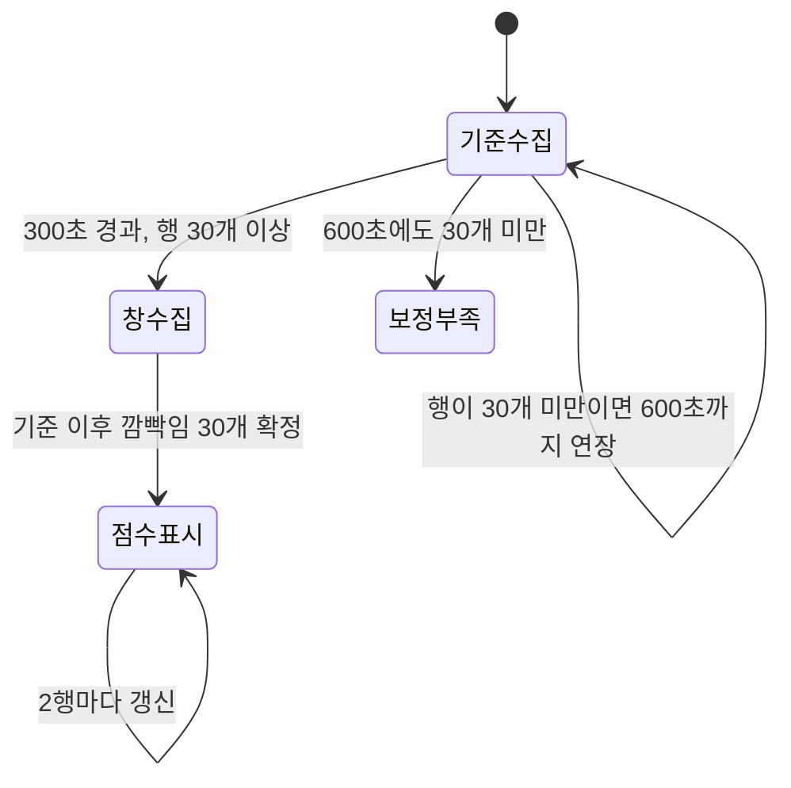
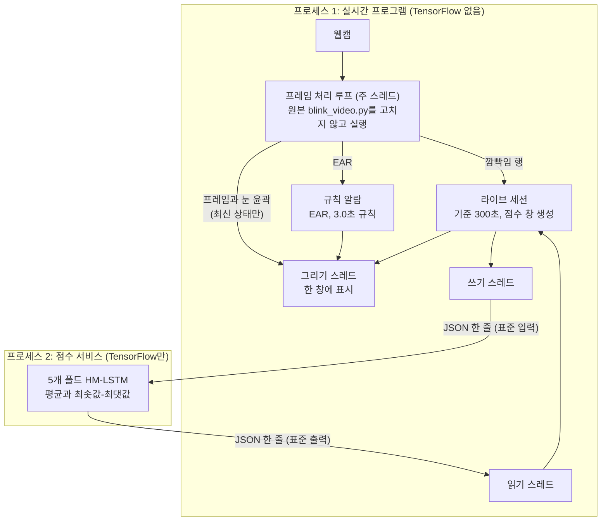
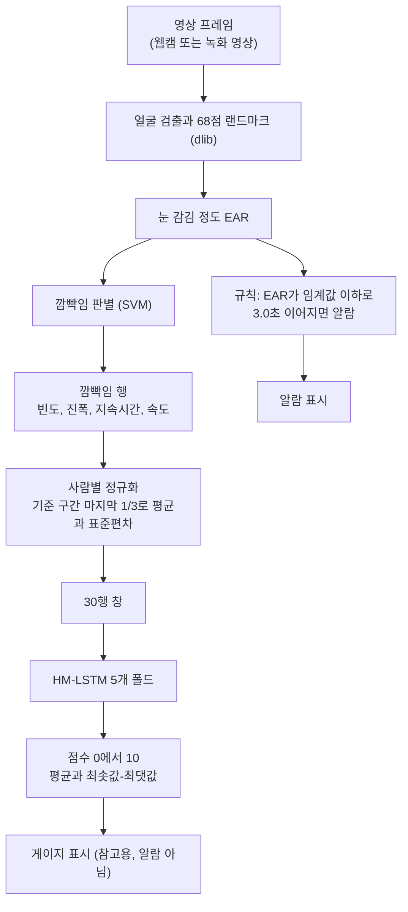
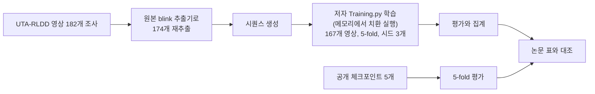

# 졸음 조기 탐지 논문 부분 재현과 실시간 데모

A Realistic Dataset and Baseline Temporal Model for Early Drowsiness Detection(CVPRW 2019, arXiv 1904.07312)의 눈 깜빡임 기반 졸음 조기 탐지 방법을 공개 데이터(UTA-RLDD)에서 부분 재현하고, 웹캠으로 동작하는 실시간 데모를 만든 개인 프로젝트입니다.

<p align="center">
  
</p>
<p align="center"><sub>알람은 눈 감김 3초 규칙 하나뿐이고, 졸음 점수 게이지는 0-10의 값으로 나타내며 졸음 판정이 아닌 참고용입니다.</sub></p>

## 한눈에 보기

- 논문의 눈 기반 방법을 저자 공개 코드와 공개 체크포인트로 다시 돌려 논문 표와 대조했습니다(14칸 중 11칸 일치, 3칸 불일치). 영상에서 특징을 직접 다시 뽑아 학습한 기준선 B1은 영상 집합이 달라 논문과 같은 비교가 아닙니다. B1은 "우리가 영상에서 다시 뽑은 특징으로 저자 코드를 그대로 학습한 결과"이고, 용어는 [용어 표](docs/REPRODUCTION_RESULTS.md#2-용어-설명)에 있습니다.
- 웹캠 한 창에서 눈 감김 규칙 알람과 HM-LSTM(논문이 쓰는 시간 모델) 점수 게이지가 함께 동작합니다.
- 원본 코드를 고치지 않고 끼워 넣는 방식으로 실시간 경로를 만들고, 저장된 영상 경로와 값이 같은지 검증했습니다.
- 졸음을 판정하는 제품이 아닙니다. 한계는 아래 "한계와 데이터 정책"에 있습니다.

## 1. 프로젝트 개요

### 문제 정의

논문은 눈 깜빡임에서 뽑은 특징(빈도, 진폭, 지속시간, 속도)의 시퀀스를 HM-LSTM 기반 시간 모델에 넣어 졸음 정도 라벨(클래스 0, 5, 10)을 추정하고, 이를 위한 데이터셋 UTA-RLDD를 함께 제안합니다(논문 원문은 이 저장소에 없습니다). 이 저장소는 그 눈 기반 부분을 공개 코드로 재현해 일치하는 것과 일치하지 않는 것을 점검하고(재현 트랙), 재현한 부분을 눈 감김 3.0초 규칙 알람과 참고용 점수 게이지로 나누어 활용합니다(활용 트랙).

### 목표

| 목표 | 짧은 비고 |
|---|---|
| 논문 재현(기준선 B1) | 저자 코드와 하이퍼파라미터 그대로 학습. 영상 집합이 달라 논문과 같은 비교가 아님 |
| 눈 감김 규칙 알람(3.0초) | 실험 전에 기준을 정해 둔 영상 실험 2건(한 건 일치, 한 건 불일치, 영상 각 1개) |
| 실시간 웹캠 데모 | 규칙 알람과 점수 게이지를 한 창에 구동. 한 사람, 한 카메라 관찰 |
| HM-LSTM 점수 게이지(참고용) | 점수 계산 경로가 저장된 값과 일치. 졸음을 반영하는지는 검증하지 못함 |
| 재현 가능한 검증 절차 | 영상 경로 대조와 라이브 재채점으로 확인(4절) |

### 기간과 역할

기간은 2026-09-30에서 2026-10-14(2주)입니다. 개인 프로젝트(1인)이며, 연구 설계, 검증 기준과 사전 등록, 결과 해석과 설계 결정은 본인이 담당했고, 코드 구현과 문서 초안 작성에는 AI 코딩 도구(Claude Code)를 활용했습니다.

### 기술 스택

Python 3.6.13(conda 환경 `ghoddoosian_tf1`), TensorFlow 1.8.0, OpenCV 3.4.5, dlib 19.17, scikit-learn 0.19.2, numpy 1.14.6, Pillow 8.3.1, `unittest`. 저자 코드는 `third_party/ghoddoosian/`에 수정 없이 포함했습니다([envs/environment_tf1.yml](envs/environment_tf1.yml)).

### 엔지니어링 포인트

1. **원본 코드 무수정**: 저자의 `blink_video.py`를 고치지 않고 실행할 때 메모리에서 텍스트를 치환해 끼워 넣습니다. 원본 파일 44개(코드, 체크포인트, 특징 파일)는 평가 도구가 시작할 때 해시로 변경 여부를 확인합니다.
2. **프로세스와 스레드 분리**: dlib 호출 중에는 같은 프로세스의 다른 스레드 연산이 54%에서 90% 줄어드는 것을 쟀습니다(파이썬이 한 번에 한 스레드만 실행하게 하는 잠금, GIL의 영향). 그래서 TensorFlow 점수 계산은 별도 프로세스에 두고 JSON 한 줄씩 주고받으며, 그리기는 별도 스레드에서 합니다.
3. **실시간 예산 실측**: 프레임 예산 약 33 ms 중 처리 시간 중앙값은 25.3 ms와 25.5 ms(예산의 약 76%)였습니다. 웹캠 약 600초 실행 2회, 한 사람과 한 카메라에서 잰 값이고, 최댓값은 예산을 넘는 프레임이 있었습니다.
4. **사전 정한 기준으로 검증**: 규칙 알람 실험과 점수 경로 대조는 기준을 먼저 정하고 결과와 대조했습니다. 웹캠 실행에 쓰는 원본 연결 방식을 영상 파일에 돌려 저장된 영상 경로와 눈 감김 값, 프레임 수, 깜빡임 행을 비교했습니다(영상 2개).
5. **재채점 일치**: 라이브 실행에서 저장한 깜빡임 행을 다시 넣어 점수를 계산했을 때 창 100개의 프레임 번호와 점수가 최대 차이 0으로 일치했습니다. 같은 코드로 같은 행을 다시 채점한 비교이며 B1 경로와의 비교가 아닙니다.

## 2. 시연

세션은 기준 수집, 창 수집, 점수 표시 순서로 진행합니다.



| 1. 기준 수집 중 | 2. 깜빡임 수집 중 | 3. 점수 표시 |
|:-:|:-:|:-:|
|  |  |  |
| 처음 300초 동안 그 사람의 기준을 모읍니다. | 기준 이후 깜빡임이 쌓이는 중입니다. | 점수는 0에서 10, 참고용이며 알람이 아닙니다. |

웹캠 시연 영상은 발표 자료(PPT) 안에 있습니다. 링크 추가 예정.

## 3. 시스템 구조



쓰기 스레드와 읽기 스레드는 두 프로세스 사이에서 JSON 한 줄씩 주고받는 통신 담당입니다.



EAR는 눈이 감길수록 작아지는 눈 가로세로 비율입니다.

## 4. 기준선 B1 재현과 검증

**어떻게**: UTA-RLDD 영상에서 저자의 원본 blink 추출기로 깜빡임을 다시 뽑고, 저자의 `Training.py`를 메모리에서 치환 실행해 학습한 뒤(5-fold, 시드 3개) 논문 표와 대조했습니다. 5-fold는 데이터를 5조각으로 나눠 돌아가며 평가하는 방식입니다. 저자가 공개한 체크포인트 5개도 같은 방식(메모리 치환)으로 평가했습니다.



**어디까지**: 영상 단위 정답률(VA, 영상 한 편마다 답을 하나 내서 맞은 영상의 비율)은 B1이 5-fold 평균 0.586, 공개 체크포인트가 0.649였습니다. 두 값은 영상 집합이 달라 같은 비교가 아닙니다. 공개 체크포인트 평가를 논문 표와 대조한 14칸 중 11칸은 일치하고 3칸(Fold3 VA, Fold3 VRE, 평균 VRE)은 일치하지 않았으며 원인은 확인하지 못했습니다.

**논문과 공개 코드의 불일치**: 이산화 경계(논문 3.3과 6.6, 코드 3.34와 6.68), 피험자별 정규화 구간(논문 처음 1/3, 코드 마지막 1/3), 영상 수(논문 180, 저자 코드 테스트 174) 같은 불일치를 확인해 문서화했고 원본을 그대로 따랐습니다. 논문 쪽 값은 사용자 확인에 근거하며 논문 원문(PDF)은 저장소에 없습니다. 상세는 [재현 보고서](docs/REPRODUCTION_REPORT.md)의 문제점 표에 있습니다.

**하지 않은 것**: 논문의 눈 기반 부분만 다뤘고 전체 방법은 재현하지 않았습니다. 실제 운전 환경이나 다른 사람들로의 일반화는 검증하지 않았습니다.

**검증**: 실시간 경로가 저장 영상 경로와 같은 값을 내는지 네 가지로 확인했습니다. 추출 단계의 깜빡임 행이 B1 행과 같은지(영상 2개, 열별 최대 차이 0), 영상에서 점수까지 전체 경로가 저장된 B1 값과 같은지(영상 2개), 실시간 연결 방식의 눈 감김 값과 프레임 수와 깜빡임 행이 영상 경로와 같은지(영상 2개), 라이브 저장 행의 재채점이 같은지입니다.

값, 용어 표, 검증 표 전체는 [docs/REPRODUCTION_RESULTS.md](docs/REPRODUCTION_RESULTS.md)에 있습니다.

## 5. 규칙 알람

눈 감김 값(EAR)이 0.15 이하로 3.0초 연속되면 알람을 울립니다(0.15는 사용자 1명의 체험으로 정한 값입니다). 0.3초 미만의 눈 뜸은 이어진 것으로 보고, 얼굴이 1.0초 이상 보이지 않으면 그 구간은 버립니다. 점수와 무관하게 이 규칙만 알람을 울립니다. 알람 시각 대조에는 오차 한계가 있습니다. 규칙 알람 실험 E-02(영상 1개)의 정답 시각은 영상 재생기 표시 기준이며 ±1초 오차가 있고, 알람 시각을 알고 본 것이므로 블라인드가 아닙니다([IMPROVEMENT_LOG.md](docs/improvement/IMPROVEMENT_LOG.md)의 "E-02 실행 결과 (2026-10-07)").

## 6. HM-LSTM 점수 게이지

처음 300초(깜빡임이 30개 미만이면 600초까지)의 깜빡임으로 그 사람의 기준을 만들고, 이후 깜빡임 30개로 만든 창마다 5개 폴드 모델의 평균과 최솟값-최댓값(0에서 10)을 보여 줍니다. 참고용입니다. 오프라인 분석(영상 167개)에서 깨어 있음(클래스 0)과 나머지를 가르는 지표(AUC)는 0.89에서 0.93이지만 클래스 5와 10을 가르는 지표는 0.61이라(0.5가 우연 수준), 점수로 알람을 만들지 않았습니다. AUC는 [용어 표](docs/REPRODUCTION_RESULTS.md#2-용어-설명)에 풀어 두었습니다.

## 7. 실행 방법

```
conda activate ghoddoosian_tf1
set PYTHONPATH=src
python -m improve.hmlstm.live_combined 0 --predictor <PREDICTOR> --ckpt-root <CKPT_DIR>
```

처음 300초는 자연스럽게 앉아 있어야 하고, 종료는 q입니다. 점수 없이 규칙 알람만 보려면 `--no-score`를 붙입니다(이때 `--ckpt-root`는 필요하지 않습니다). 환경 만들기, 데이터 준비, 테스트, 재현 실행, 측정 도구까지 [docs/RUN_GUIDE.md](docs/RUN_GUIDE.md)에 있습니다. 데이터 없이 되는 시험부터 시작할 수 있습니다.

## 8. 저장소 구조

```
third_party/ghoddoosian/       원본 코드, 체크포인트, 특징 파일(수정 없음, MIT; THIRD_PARTY.md 참고)
src/repro/                     재현 트랙 스크립트(영상 조사, blink 재추출, 시퀀스 생성, 학습, 평가, 진단)
src/improve/rules/             눈 감김 규칙 알람, 웹캠 데모, 재생 뷰어
src/improve/hmlstm/            HM-LSTM 점수 도구와 라이브 도구
scripts/                       재학습 일괄 실행 배치 파일
experiments/00_reproduction/   공개 체크포인트 평가 결과와 Fold1 학습 기록
experiments/01_fold1_seeds/    Fold1 시드 1에서 5 재학습 결과
experiments/02_fold_seeds/     Fold2에서 5의 시드 1에서 3 재학습 결과와 집계 파일
configs/                       원본 파일 해시 목록, 영상 목록과 회전 조사 CSV
envs/environment_tf1.yml       conda 환경(Python 3.6, TensorFlow 1.8)
data/README.md                 데이터 입수 방법(저장소에는 데이터를 넣지 않음)
docs/                          재현 트랙 문서, 활용 트랙 문서(docs/improvement/), 시연 화면(docs/images/)
```

`src/improve`는 활용 트랙의 코드 폴더입니다. `src/improve/demo/`, `experiments/improve/`, `configs/improve/`, `docs/figures/`는 자리만 있고 비어 있습니다. 재현 트랙과 활용 트랙의 경계와 의존 방향은 [docs/improvement/README.md](docs/improvement/README.md)에 있습니다.

## 9. 한계와 데이터 정책

- 측정은 한 사람, 한 카메라, 일부 실행 기준이고 Windows에서만 실행해 봤습니다.
- 점수 게이지는 졸음을 판정하지 않습니다. 사건과 점수의 대조는 대본 영상 한 건(한 사람의 한 번 촬영)이라 점수가 졸음을 반영하는지 말할 수 없습니다. 처음 300초 기준 구간이 졸음 없는 상태라는 보장도 없습니다.
- 졸음 검출을 주장하지 않습니다. 규칙 알람은 눈 감김 규칙 하나뿐이고 의료 기기도, 안전 장치도 아닙니다.
- B1 대비 개선을 주장하지 않습니다. B1과 논문의 수치는 영상 집합이 달라 같은 비교가 아닙니다.

| 대상 | 저장소에 있는가 | 이유와 근거 |
|---|---|---|
| UTA-RLDD 영상과 그로부터 만든 프레임 | 없음 | 데이터 이용 지침. 얼굴 이미지는 `configs/image_publishable.csv`의 36명만 공개할 수 있고 `src/repro/publish_guard.py`를 통해서만 저장(결정 I-32). 받는 방법은 [data/README.md](data/README.md) |
| dlib 랜드마크 모델 | 없음 | 원저자 저장소의 파일이 아니라 별도 배포([data/README.md](data/README.md)) |
| 사용자 개인 영상 | 없음 (발표 자료에서만 사용) | 촬영한 원본 영상 파일은 올리지 않음(결정 I-32, 결정 I-34) |
| 숫자 JSON(깜빡임 행, 프레임 번호, 점수) | 저장소 밖에만 | 도구가 저장소 안 경로를 거부. 숫자로 그린 집계 그래프는 올릴 수 있으나 프레임과 얼굴이 식별되는 이미지는 넣지 않음(결정 I-34) |
| 웹캠 GUI 스크린샷 4장 | 있음 (본인 얼굴, 본인 동의) | 결정 I-36 |
| 저자 원본 코드, 체크포인트, 특징 파일 44개 | 있음 (수정 없음) | 결정 I-W-31. MIT 적용 범위는 확인하지 못해 [THIRD_PARTY.md](THIRD_PARTY.md)에 적음 |

## 10. 라이선스와 인용

- 이 저장소가 직접 만든 코드와 문서(`src/`, `docs/`, `configs/`, `envs/`, `data/`): MIT, [LICENSE](LICENSE). 파일 머리에 자체 저작권 고지가 있는 파생 파일은 그 고지를 따릅니다.
- `third_party/` 아래 코드: 원저자의 MIT 라이선스(저자 고지는 `third_party/ghoddoosian/LICENSE`), 수정하지 않은 사본입니다. 수정 사본, 데이터와 모델 파일의 범위, dlib 모델과 데이터셋 영상을 포함하지 않는다는 내용은 [THIRD_PARTY.md](THIRD_PARTY.md)에 있습니다.
- 이 저장소, 사전학습 체크포인트, 원본 코드를 사용할 때는 원논문(arXiv 1904.07312)을 인용하세요. 공식 5-fold 분할로 평가하고 단일 fold가 아니라 5-fold 평균을 보고하세요.

```bibtex
@inproceedings{ghoddoosian2019realistic,
  title={A Realistic Dataset and Baseline Temporal Model for Early Drowsiness Detection},
  author={Ghoddoosian, Reza and Galib, Marnim and Athitsos, Vassilis},
  booktitle={Proceedings of the IEEE Conference on Computer Vision and Pattern Recognition Workshops},
  pages={0--0},
  year={2019}
}
```

## 11. 향후 과제

- 여러 사람과 카메라 환경에서 검증하기
- 저장 파일의 시각 계산이 30fps를 가정하는 결함을 고치고 실행 설정을 함께 기록하기
- 화면 갱신 속도 개선(설정 15Hz, 실측 약 10.7Hz)

## 12. 문서 안내

- [docs/RUN_GUIDE.md](docs/RUN_GUIDE.md): 실행 방법
- [docs/REPRODUCTION_RESULTS.md](docs/REPRODUCTION_RESULTS.md): 재현 결과와 검증
- [docs/REPRODUCTION_REPORT.md](docs/REPRODUCTION_REPORT.md): 재현 보고서(단계별 방법과 전체 표)
- [docs/improvement/IMPROVEMENT_LOG.md](docs/improvement/IMPROVEMENT_LOG.md): 활용 트랙의 날짜순 상세 실험 기록
- [docs/improvement/DECISIONS.md](docs/improvement/DECISIONS.md): 활용 트랙의 결정 기록
- [docs/README.md](docs/README.md): 전체 문서 목록

날짜순 기록 문서와 사전 등록, 평가 규칙 문서는 기록 보존을 위해 고치지 않아서, 범위를 적은 물결표가 GitHub 미리보기에서 취소선으로 보이는 줄이 있습니다. 원문 텍스트는 그대로입니다.
