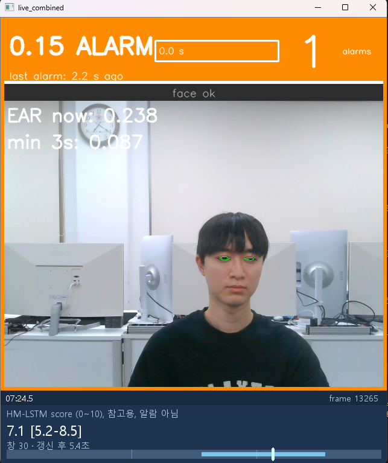
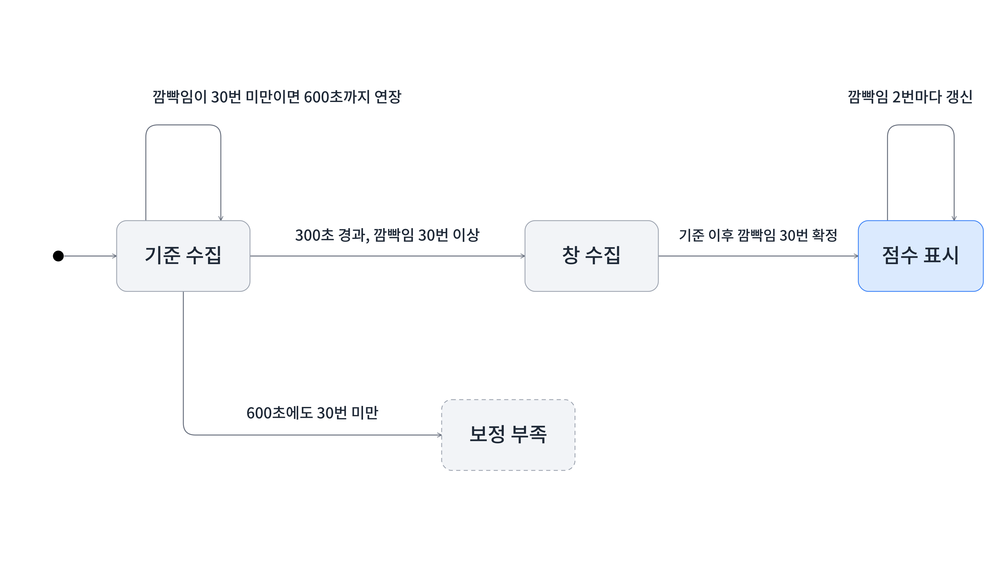
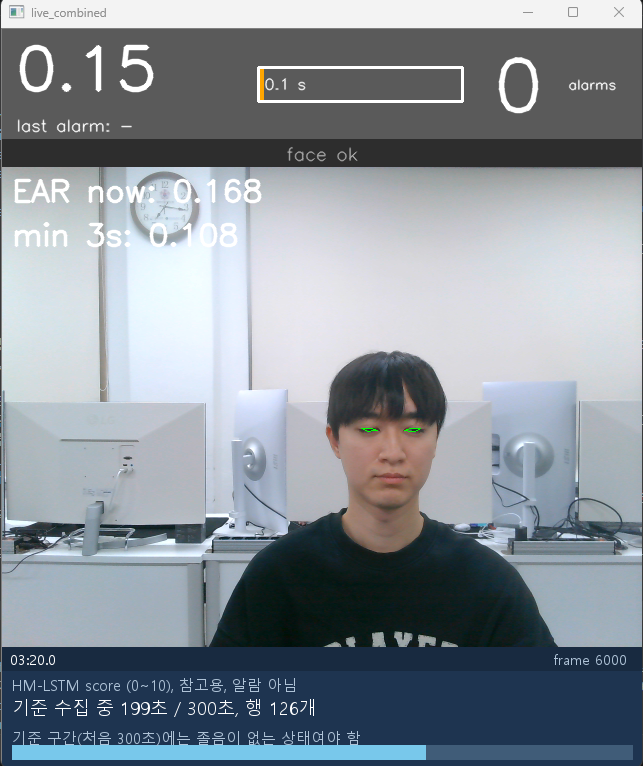
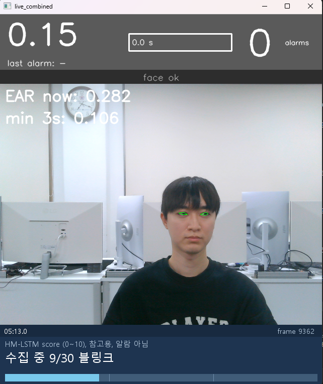
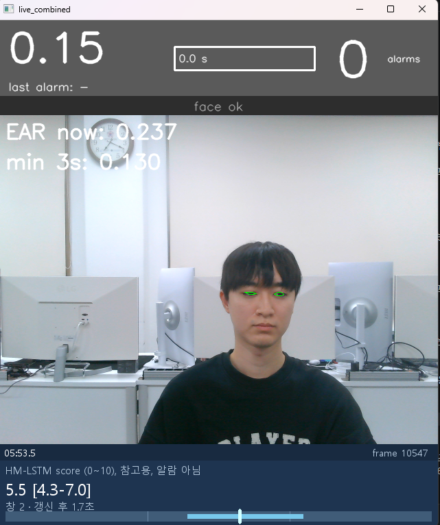
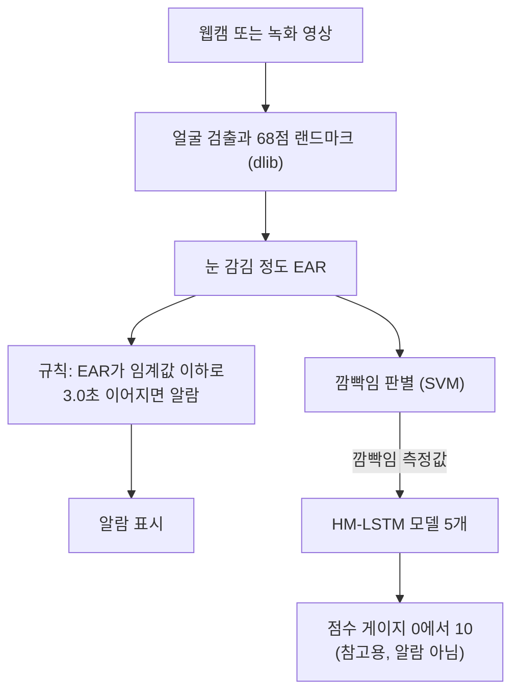
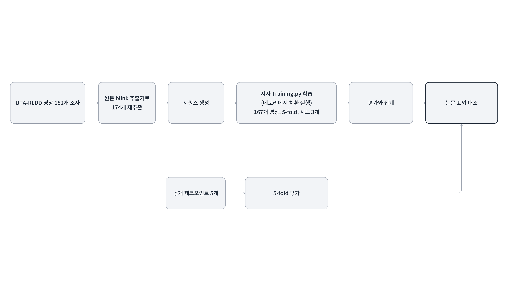

# 졸음 조기 탐지 논문(CVPRW 2019) 재현과 실시간 알람 데모

Ghoddoosian 외 2명(CVPRW 2019)이 제안한 눈 깜빡임 기반 졸음 조기 탐지 방법을 저자 공개 코드와 데이터셋 UTA-RLDD로 재현하고, 여기에 웹캠 실시간 경로, 눈 감김 3초 규칙 알람, 참고용 점수 게이지를 더한 개인 프로젝트입니다. 논문: A Realistic Dataset and Baseline Temporal Model for Early Drowsiness Detection(arXiv 1904.07312).

<p align="center">
  
</p>
<p align="center"><sub>알람은 눈 감김 3초 규칙 하나뿐이고, 졸음 점수 게이지는 0-10의 값으로 나타내며 졸음 판정이 아닌 참고용입니다.</sub></p>

## 프로젝트 요약

**재현**

- 논문의 방법(눈 깜빡임 특징 기반)을 저자 공개 코드와 공개 체크포인트로 다시 돌려 논문 표와 대조했습니다(논문 표의 수치 14개 중 11개 일치, 3개 불일치). 평가는 사람 단위로 나눈 5-fold입니다.
- 영상에서 특징을 직접 다시 뽑아 저자 코드로 재학습한 모델 B1은 영상 집합이 달라 논문과 같은 비교가 아닙니다. B1은 "우리가 영상에서 다시 뽑은 특징으로 저자 코드를 그대로 학습한 결과"이고, 용어는 [용어 표](docs/REPRODUCTION_RESULTS.md#2-용어-설명)에 있습니다.

**확장**

- 웹캠 한 화면에서 눈 감김 규칙 알람과 HM-LSTM(논문이 쓰는 시간 모델) 점수 게이지가 함께 동작합니다.
- 원본 파일은 수정하지 않고, 실행할 때 메모리 안에서 입력 연결 줄과 값을 읽어 오는 호출만 바꿔 실시간 경로를 만들었습니다. 저장된 영상 경로와 값이 같은지도 검증했습니다.
- 졸음을 판정하는 제품이 아닙니다. 한계는 아래 "한계와 데이터 정책"에 있습니다.

## 1. 프로젝트 개요

### 문제 정의

자동차에서는 운전자의 주의 상태를 감지해 부주의 알림과 휴식 권고를 보여 주는 기능이 이미 제공되고 있습니다(제네시스 운전자 주의 알림 서비스 안내). 이 프로젝트는 그런 문제의식을 운전에 한정하지 않고 여러 환경으로 넓혀, 눈 깜빡임으로 졸음을 조기에 탐지하는 논문의 방법을 재현하고 활용 방안을 살펴보았습니다.
논문은 눈 깜빡임에서 뽑은 특징(빈도, 진폭, 지속시간, 속도)의 시퀀스를 HM-LSTM 기반 시간 모델에 넣어 졸음 정도 라벨(클래스 0, 5, 10)을 추정하고, 이를 위한 데이터셋 UTA-RLDD를 함께 제안합니다(논문 원문 PDF는 이 저장소에 없고 arXiv 1904.07312로 가리킵니다). 이 저장소는 그 방법을 공개 코드로 재현해 일치하는 것과 일치하지 않는 것을 점검하고(재현 트랙), 재현한 모델을 눈 감김 3.0초 규칙 알람과 참고용 점수 게이지로 나누어 활용합니다(활용 트랙).

### 목표

| 목표 | 짧은 비고 |
|---|---|
| 논문 재현(재학습 모델 B1) | 저자 코드와 하이퍼파라미터 그대로 학습. 영상 집합이 달라 논문과 같은 비교가 아님 |
| 눈 감김 규칙 알람(3.0초) | [실험 전에 기준을 정해 둔](docs/PREREGISTERED_CRITERIA.md) 영상 실험 2건. 한 건 일치, 한 건 불일치. E-01은 외부 데모 영상 1개(운전자 4명 편집본), E-02는 본인 촬영 영상 2개(정상 대조 1개, 대본 1개)입니다. |
| 실시간 웹캠 데모 | 규칙 알람과 점수 게이지를 한 화면에 구동. 한 사람, 한 카메라 관찰 |
| HM-LSTM 점수 게이지(참고용) | 점수 계산 경로가 저장된 값과 일치. 졸음을 반영하는지는 검증하지 못함 |
| 재현 가능한 검증 절차 | 영상 경로 대조와 라이브 재채점으로 확인(4절) |

### 기간과 역할

기간은 2026-09-30에서 2026-10-14(2주)이고, 개인 프로젝트(1인)입니다.

| 구분 | 담당 | 내용 |
|---|---|---|
| 본인 | 연구 설계, 검증 기준 정의, 결과 해석, 설계 결정 | 무엇을 재현하고 무엇을 확장할지 정하고, 규칙 알람 실험(E-01, E-02)과 점수 경로 대조의 [기준을 실행 전에 정해](docs/PREREGISTERED_CRITERIA.md)(일부는 나중에 바뀌었고 문서에 기록) 그 기준으로 결과를 판단했습니다. |
| 본인 | 실행과 측정 | 웹캠 실행과 측정, 장시간 학습 실행, 결과 확인, 커밋과 푸시를 직접 했습니다. |
| AI 도구(Claude Code) | 코드 구현, 문서 초안 작성 | 본인이 요구사항을 정하고, 결과를 검토해 승인했습니다. |

### 기술 스택

**개발 환경**

| 항목 | 내용 |
|---|---|
| 운영체제 | Windows |
| Python | 3.6.13 |
| 가상환경 | conda, 환경 이름 `ghoddoosian_tf1`([envs/environment_tf1.yml](envs/environment_tf1.yml)) |
| 카메라 | 실시간 도구는 웹캠 한 대 필요(640x480 요청). 영상 파일 도구는 필요 없음 |
| GPU | 사용하지 않음(CPU 전용) |

**개발 도구**

| 구분 | 도구 | 용도 |
|---|---|---|
| IDE | VS Code | 코드와 문서 편집 |
| AI 코딩 도구 | Claude Code | 코드 구현과 문서 초안 작성에 활용 |
| 버전 관리 | Git | 변경 이력 관리 |
| 커밋과 푸시 | GitHub Desktop | 커밋과 푸시에 사용 |
| 저장소 호스팅 | GitHub | 저장소 공개, 문서와 Mermaid 다이어그램 표시 |
| 시험 | unittest | 파이썬 기본 제공 시험 도구 |

**라이브러리**

| 구분 | 이름 | 버전 | 용도 |
|---|---|---|---|
| 영상 처리 | OpenCV | 3.4.5 | 웹캠과 영상 읽기, 화면 표시, 눈 윤곽 그리기, 회전, 광학 흐름(저자 코드) |
| 영상 처리 | dlib | 19.17 | 얼굴 검출과 68점 랜드마크 |
| 영상 처리 | imutils | 0.5.4 | 영상 크기 줄이기, 랜드마크를 좌표 배열로 바꾸기 |
| 수치 계산 | numpy | 1.14.6 | 눈 감김 값, 깜빡임 측정값, 창, 정규화 계산 |
| 수치 계산 | scipy | 1.2.1 | 눈 거리 계산과 시계열 이동과 필터(저자 코드와 그 덤프용 복사본) |
| 수치 계산 | pandas | 1.1.5 | 코드에서 쓰지 않음. 환경에 설치되어 있지만 numpy 1.14.6과 함께는 불러올 수 없음 |
| 딥러닝 | TensorFlow | 1.8.0 | HM-LSTM 학습과 점수 계산. 실시간 프로그램에서는 불러오지 않고 점수 서비스(별도 프로세스)에서만 씀 |
| 머신러닝 | scikit-learn | 0.19.2 | 영상 요약 특징 진단 분류기(로지스틱, RF). 저자의 깜빡임 판별 SVM 파일을 읽는 데도 필요(저자 코드 의존) |
| 시각화 | matplotlib | 2.2.5 | 점수 시간선 그림(PNG). (저자 코드와 동일) |
| 시각화 | Pillow | 8.3.1 | 화면에 한글 문구 그리기(재생 뷰어, 실시간 프로그램) |

### 구현과 검증 방식

1. **원본 파일 무수정**: 저자의 `blink_video.py` 파일은 그대로 두고, 실행할 때 메모리 안에서 15줄만 바꿔 실행합니다(입력과 출력 경로, 영상 읽기, 화면 표시와 종료 처리 같은 연결 줄 13줄과, 눈 감김 값을 읽어 오는 호출 두 줄). 파일 자체는 바뀌지 않습니다. 원본 파일 44개(코드, 체크포인트, 특징 파일)는 평가 도구가 시작할 때 해시로 변경 여부를 확인합니다. 같은 방식으로 영상 파일도 처리해 저장된 영상 경로와 눈 감김 값, 프레임 수, 깜빡임 측정값을 비교했습니다(데이터셋 영상 2개).
2. **프로세스와 스레드 분리**: dlib 호출 중에는 같은 프로세스의 다른 스레드 연산이 54%에서 90% 줄어드는 것을 쟀습니다(파이썬이 한 번에 한 스레드만 실행하게 하는 잠금, GIL의 영향). 그래서 TensorFlow 점수 계산은 별도 프로세스에 두고 JSON 한 줄씩 주고받으며, 그리기는 별도 스레드에서 합니다.
3. **실시간 처리 속도 실측**: 웹캠은 프레임(영상 한 장)을 약 33 ms마다 보내므로 한 장을 그 안에 처리해야 화면이 끊기지 않습니다. 처리 시간의 중앙값은 25.3 ms와 25.5 ms로 그 시간의 약 76%였습니다. 웹캠 약 600초 실행 2회, 한 사람과 한 카메라에서 잰 값이고, 33 ms를 넘긴 프레임도 있었습니다.
4. **사전 기준 검증**: 규칙 알람 실험과 점수 경로 대조는 실행 전에 합격 기준을 정해 두고 그 기준으로 판정했습니다(기록으로 순서를 확인하지 못한 항목은 문서에 표시). 기준 내용과 나중에 바뀐 것은 [사전 기준 정리](docs/PREREGISTERED_CRITERIA.md)에 있습니다. 2건은 결과를 본 뒤 달라졌고(허용 오차 완화 1건, 사전 기준을 충족하지 못한 채 정한 임계값 0.15 1건) 변경 내역도 같은 문서에 있습니다.
5. **재채점 일치**: 라이브 실행에서 저장한 깜빡임 측정값을 다시 넣어 점수를 계산했을 때 창 100개의 프레임 번호와 점수가 최대 차이 0으로 일치했습니다. 같은 코드로 같은 측정값을 다시 채점한 비교이며 B1 경로와의 비교가 아닙니다.

## 2. 시연

프로그램을 시작하면 기준 수집, 창 수집, 점수 표시 순서로 진행합니다.



이 그림의 '깜빡임 N번'은 코드가 세는 측정값 N개를 뜻하며, 실제 눈 깜빡임 횟수와 정확히 같다고 확인하지 못했습니다(3절 설명 참고).

| 1. 기준 수집 중 | 2. 깜빡임 수집 중 | 3. 점수 표시 |
|:-:|:-:|:-:|
|  |  |  |
| 처음 300초 동안 그 사람의 기준을 모읍니다. | 기준 이후 깜빡임이 쌓이는 중입니다. | 점수는 0에서 10, 참고용이며 알람이 아닙니다. |

웹캠 시연 영상은 발표 자료(PPT) 안에 있습니다.

## 3. 데이터 흐름



1. **EAR**: 눈이 감길수록 작아지는 눈 가로세로 비율입니다.
2. **SVM(깜빡임 판별)**: EAR가 변하는 모양에서 깜빡임 1번을 찾고, 한 번마다 빈도, 진폭, 지속시간, 속도 4가지를 잽니다. 이 4가지가 깜빡임 측정값입니다. (코드와 기록 문서에서는 이 한 번의 측정값을 '행'이라 부르며, 이 README의 "깜빡임 N번"은 코드가 세는 '행 N개'를 뜻합니다. 한 번의 확정에서 여러 줄이 기록되기도 하고 일부는 기록되지 않아서 실제 눈 깜빡임 횟수와 정확히 같다고 확인하지 못했고, 수동으로 센 횟수와의 비교는 하지 않았습니다.)
3. **본인 기준 조정**: 깜빡임은 사람마다 달라서 측정값을 그대로 쓰지 않고 본인의 평소 값에 맞춰 조정합니다. 시작 후 처음 300초(기준 구간, 깜빡임이 30번 미만이면 600초까지 연장)의 깜빡임 중 마지막 1/3로 평균과 표준편차를 구해 씁니다.
4. **HM-LSTM**: 조정한 측정값 중 최근 깜빡임 30번 묶음(창)을 입력으로 받아 0에서 10 사이의 점수를 냅니다. 이 저장소에서 직접 학습한 모델 5개(교차검증 폴드마다 1개)를 모두 돌려 5개 점수의 평균과 최솟값-최댓값을 보여 줍니다.
5. **점수 게이지**는 참고용이며 알람을 울리지 않습니다. 알람은 위쪽 규칙(3.0초)만 담당합니다.

## 4. 논문 재현과 검증

**데이터셋(UTA-RLDD)**

- 참가자 60명이 한 사람당 영상 3개(깨어 있음, 각성 저하, 졸음 각 1개)를 직접 촬영해 총 180개이고, 영상 한 편은 약 10분, 전체는 약 30시간입니다(논문 3.1절, 3.3절).
- 라벨은 클래스 0(깨어 있음), 5(각성 저하, 졸음의 미묘한 징후가 나타나는 상태), 10(졸음) 세 가지이며, 촬영한 참가자가 Karolinska 졸음 척도(KSS, 1에서 9까지의 자기 보고 척도)로 그 영상의 주된 상태를 직접 정했습니다(깨어 있음 1에서 3, 각성 저하 6과 7, 졸음 8과 9, 논문 3.2절, 3.3절). 객관적 측정이 아니라 참가자의 주관적 판단이며 논문도 라벨 결정에 주관적 요소가 있다고 밝힙니다(논문 3.3절).
- 영상은 참가자가 집이나 학교에서 자기 휴대전화나 웹캠으로 찍어 해상도와 화질이 제각각이고 초당 프레임 수는 30 미만이며, 운전 중에 찍은 것이 아닙니다(논문 3.1절에서 3.3절, 서론 2쪽).

**영상 구성**

| 단계 | 영상 수 | 내용 |
|---|---|---|
| 논문 | 180 | 60명 x 3개(깨어 있음, 각성 저하, 졸음). 5 fold x 12명 |
| 저자 코드의 테스트 영상 | 174 | 저자가 어떤 영상을 제외했는지는 확인하지 못했습니다. 공개 체크포인트 평가에 사용 |
| 이 저장소가 받은 파일 | 182 | 피험자 32와 49는 졸음 영상 파일이 2개씩 있습니다. 논문이 이 파일들을 어떻게 셌는지는 확인하지 못했습니다 |
| 깜빡임 재추출 | 174 | 182개 중 8개 제외(재생기에서 재생 불가, 화면 미표시, 형식 미지원 경고, 상하 반전을 본인이 육안으로 확인). 저자 코드의 174개와 같은 영상 집합인지는 확인하지 못했습니다 |
| B1 학습과 평가 | 167 (57명) | 7개 추가 제외: 같은 클래스의 변형 파일 4개, 깜빡임 기록 없음 1개, 기준 영상(깨어 있음) 없음 2개 |
| B0(저자 특징 파일로 재학습한 모델)의 평가 | 저자 코드와 같음 | 저자 코드와 같은 테스트 파일을 읽습니다. 영상 수를 따로 적은 기록은 없습니다 |

B1의 fold별 평가 영상 수는 33, 33, 35, 32, 34개이고 저자 코드는 33, 36, 36, 36, 33개이므로 fold별 값도 같은 영상 집합의 비교가 아닙니다.

**학습 조건 비교**

| 항목 | 저자 코드 | B0(저자 특징 파일로 재학습) | B1(이 저장소) |
|---|---|---|---|
| 에폭, 배치 크기, 학습률, 최적화 | 80, 64, 0.000053, Adam | 같음 | 같음 |
| 입력 묶음 길이와 간격 | 30, 2 | 같음 | 같음 |
| 3단계 분류 경계, 정규화 구간 | 3.34와 6.68, 마지막 1/3 | 같음 | 같음(논문 본문과는 다름, 아래 불일치 참고) |
| 입력 특징 | 저자가 제공한 특징 파일 | 같음 | 영상에서 깜빡임을 다시 추출 |
| 시드 | 고정하지 않음 | 1, 2, 3으로 고정 | 1, 2, 3으로 고정 |
| 실행 환경 | Ubuntu 16.04, TensorFlow 1.8 | Windows, CPU, TensorFlow 1.8.0 | Windows, CPU, TensorFlow 1.8.0 |
| 검증 세트와 조기 종료 | 없음(매 에폭 테스트 세트로 지표 출력) | 없음. 보고값은 마지막 에폭(80) | 없음. 보고값은 마지막 에폭(80) |

학습 알고리즘과 하이퍼파라미터는 저자 코드와 같습니다. B0가 저자 코드와 다른 것은 시드와 실행 환경이고, B1은 여기에 입력 특징과 영상 구성이 더해집니다.

**방법**: UTA-RLDD 영상에서 저자의 원본 blink 추출기로 깜빡임을 다시 뽑고, 저자의 `Training.py`를 메모리에서 치환 실행해 학습한 뒤(5-fold, 시드 3개) 논문 표와 대조했습니다. 5-fold는 사람 기준으로 데이터셋 60명을 12명씩 5묶음으로 나누고, 4묶음으로 학습해 나머지 1묶음으로 평가하는 일을 5번 해서 모델 5개를 얻는 방식입니다. 저자가 공개한 체크포인트 5개도 같은 방식(메모리 치환)으로 평가했습니다.



**결과**: 영상 단위 정답률(VA, 영상 한 편마다 답을 하나 내서 맞은 영상의 비율)은 B1이 5-fold 평균 0.586, 공개 체크포인트가 0.649였습니다. 두 값은 영상 집합이 달라 같은 비교가 아닙니다. B0의 5-fold 평균은 0.556 ± 0.036(시드 3개의 평균과 표준편차, n-1 기준)이었고, 같은 저자 테스트 파일로 평가한 공개 체크포인트의 0.649보다 낮았습니다. 평가 영상과 입력 특징을 저자의 것으로 맞춰도 격차가 남았으며, 원인은 확인하지 못했습니다. 공개 체크포인트 평가를 논문 표와 대조한 수치 14개 중 11개는 일치하고 3개(Fold3 VA, Fold3 VRE, 평균 VRE)는 일치하지 않았으며 원인은 확인하지 못했습니다. VRE는 영상 단위 오차입니다. 틀린 영상의 평균 예측이 정답 경계에서 얼마나 먼지를 모은 값이고 정답 영상은 0이어서 낮을수록 좋습니다([용어 표](docs/REPRODUCTION_RESULTS.md#2-용어-설명)).

**불일치**: 이산화 경계(논문 3.3과 6.6, 코드 3.34와 6.68), 피험자별 정규화 구간(논문 처음 1/3, 코드 마지막 1/3), 영상 수(논문 180, 저자 코드 테스트 174) 같은 불일치를 확인해 문서화했고 원본을 그대로 따랐습니다. 논문 쪽 값의 근거는 논문 원문(arXiv 1904.07312)입니다: 이산화 경계 3.3과 6.6은 4.2절 식 10(7쪽), 정규화는 알림 상태 영상의 처음 1/3 깜빡임으로 계산한다는 것은 4.2절 식 6(6쪽), 영상 180개(60명 곱하기 3)는 3.1절과 3.3절입니다. 코드 쪽 값(3.34, 6.68, 마지막 1/3, 174개)의 근거는 저장소 기록입니다. 논문 PDF는 저장소에 없어 arXiv 번호로 가리킵니다. 상세는 [재현 보고서](docs/REPRODUCTION_REPORT.md)의 문제점 표에 있습니다.

**미수행 항목**: 논문의 방법은 처음부터 끝까지 눈 깜빡임 특징만 쓰므로, 눈 기반이라는 점은 한계가 아니라 논문의 범위입니다. 논문의 비교 실험(HM-LSTM, 일반 LSTM, 완전연결 층만 쓴 변형 모델, 논문 5.3절 표 2), 사람 판단 실험(논문 3.4절), 입력 길이 T와 Δ의 민감도 실험(논문 그림 4)은 다시 하지 않았습니다. 모델 학습(`Training.py`)과 깜빡임 추출(`blink_video.py`)은 저자 코드를 고치지 않고 실행했고, 시퀀스 생성은 저자 전처리와 같은 계산을 직접 구현해 합성 데이터에서 저자 함수와 일치함을 확인했습니다. 다만 저자가 배포한 특징 파일과는 영상 단위로 거의 일치하지 않았고 원인은 확인하지 못했습니다. 평가는 같은 데이터셋 안에서 60명을 12명씩 5개 fold로 나눈 사람 단위 5-fold입니다. 데이터셋 밖(다른 카메라, 조명, 운전 환경)과 실시간 데모(한 사람, 한 카메라)는 검증하지 않았습니다. 논문도 자신의 결과가 운전 환경을 대표한다고 주장하지 않습니다(논문 서론, 2쪽).

**검증**: 실시간 경로가 저장 영상 경로와 같은 값을 내는지 네 가지로 확인했습니다. 추출 단계의 깜빡임 측정값이 B1 측정값과 같은지(데이터셋 영상 2개, 열별 최대 차이 0), 영상에서 점수까지 전체 경로가 저장된 B1 값과 같은지(데이터셋 영상 2개), 실시간 연결 방식의 눈 감김 값과 프레임 수와 깜빡임 측정값이 영상 경로와 같은지(데이터셋 영상 2개), 라이브 저장 측정값의 재채점이 같은지입니다.

값, 용어 표, 검증 표 전체는 [docs/REPRODUCTION_RESULTS.md](docs/REPRODUCTION_RESULTS.md)에 있습니다.

## 5. 규칙 알람

눈 감김 값(EAR)이 0.15 이하로 3.0초 연속되면 알람을 울립니다(0.15는 작성자 본인 1명의 웹캠 체험으로 정한 값이라 다른 사람과 카메라에서는 달라질 수 있습니다). 0.3초 미만의 눈 뜸은 이어진 것으로 보고, 얼굴이 1.0초 이상 보이지 않으면 그 구간은 버립니다. 점수와 무관하게 이 규칙만 알람을 울립니다. 알람 시각 대조에는 오차 한계가 있습니다. 규칙 알람 실험 E-02의 대본 영상(영상 1개)의 정답 시각은 영상 재생기 표시 기준이며 ±1초 오차가 있고, 알람 시각을 알고 본 것이므로 블라인드가 아닙니다([IMPROVEMENT_LOG.md](docs/improvement/IMPROVEMENT_LOG.md)의 "E-02 실행 결과").

## 6. HM-LSTM 점수 게이지

처음 300초의 기준(깜빡임이 30번 미만이면 600초까지 연장)과 깜빡임 30번 묶음으로 점수를 내는 순서는 3절의 목록과 같고, 이 저장소에서 직접 학습한 모델 5개(폴드마다 1개)의 평균과 최솟값-최댓값(0에서 10)을 창마다 보여 줍니다. 4절의 공개 체크포인트 5개와는 다른 모델입니다. 참고용입니다. 오프라인 분석(영상 167개)에서 깨어 있음(클래스 0)과 나머지를 가르는 지표(AUC)는 0.89에서 0.93이지만 클래스 5와 10을 가르는 지표는 0.61이라(0.5가 우연 수준), 점수로 알람을 만들지 않았습니다. AUC는 [용어 표](docs/REPRODUCTION_RESULTS.md#2-용어-설명)에 적어두었습니다.

## 7. 실행 방법
이 프로그램은 작성자 본인의 Windows PC에서만 실행해 봤고, 다른 컴퓨터에서 환경이 만들어지는지는 확인하지 못했습니다.

실행 전에 conda 환경, dlib 얼굴 랜드마크 모델 파일(`<PREDICTOR>`), 점수 게이지용 B1 모델 폴더(`<CKPT_DIR>`)를 준비해야 합니다. 각 항목의 설명과 준비 방법은 [RUN_GUIDE.md의 실행 준비물](docs/RUN_GUIDE.md#실행-준비물규칙-알람과-점수-게이지)에 있습니다. B1 모델은 저장소에 없으므로 점수 게이지는 직접 학습해야 합니다.

### 실행
규칙 알람만 보려면(점수 없이, `--ckpt-root` 불필요) 환경, dlib, `<PREDICTOR>`, 웹캠이 필요합니다.
```
conda activate ghoddoosian_tf1
set PYTHONPATH=src
python -m improve.hmlstm.live_combined 0 --predictor <PREDICTOR> --no-score
```
점수 게이지까지 보려면 위에 더해 `<CKPT_DIR>`가 필요합니다. B1 모델이 저장소에 없으므로 직접 학습해야 합니다.
```
conda activate ghoddoosian_tf1
set PYTHONPATH=src
python -m improve.hmlstm.live_combined 0 --predictor <PREDICTOR> --ckpt-root <CKPT_DIR>
```
처음 300초는 자연스럽게 앉아 있어야 하고, 종료는 q입니다. 환경 만들기, 데이터 준비, 테스트, 재현 실행, 측정 도구까지 [docs/RUN_GUIDE.md](docs/RUN_GUIDE.md)에 있습니다. 데이터 없이 되는 시험부터 시작할 수 있습니다.

## 8. 저장소 구조

```
third_party/ghoddoosian/       원본 코드, 체크포인트, 특징 파일(수정 없음, MIT; THIRD_PARTY.md 참고)
src/repro/                     재현 트랙 스크립트(영상 조사, blink 재추출, 시퀀스 생성, 학습, 평가, 진단)
src/improve/rules/             눈 감김 규칙 알람, 웹캠 데모, 재생 뷰어
src/improve/hmlstm/            HM-LSTM 점수 도구와 라이브 도구
scripts/                       재학습 일괄 실행 배치 파일
experiments/00_reproduction/   공개 체크포인트 평가 결과와 Fold1 학습 기록
experiments/01_fold1_seeds/    Fold1 시드 1에서 5 재학습 결과
experiments/02_fold_seeds/     Fold2에서 5의 시드 1에서 3 재학습 결과와 집계 파일
configs/                       원본 파일 해시 목록, 영상 목록과 회전 조사 CSV
envs/environment_tf1.yml       conda 환경(Python 3.6, TensorFlow 1.8)
data/README.md                 데이터 입수 방법(저장소에는 데이터를 넣지 않음)
docs/                          재현 트랙 문서, 활용 트랙 문서(docs/improvement/), 시연 화면(docs/images/)
```

`src/improve`는 활용 트랙의 코드 폴더입니다. `src/improve/demo/`, `experiments/improve/`, `configs/improve/`, `docs/figures/`는 자리만 있고 비어 있습니다. 재현 트랙과 활용 트랙의 경계와 의존 방향은 [docs/improvement/README.md](docs/improvement/README.md)에 있습니다.

## 9. 한계와 데이터 정책

- 웹캠 실시간 측정은 작성자 본인 한 사람, 한 카메라로 했고, E-02는 작성자 본인 한 사람, 한 환경(촬영 카메라는 기록에 없음)으로 했으며, E-01은 외부 영상(운전자 4명 편집본)으로 했습니다. 일부 실행 기준이고 Windows에서만 실행해 봤습니다.
- 점수 게이지는 졸음을 판정하지 않습니다. 사건과 점수의 대조는 대본 영상 한 건(한 사람의 한 번 촬영)이라 점수가 졸음을 반영하는지 말할 수 없습니다. 처음 300초 기준 구간이 졸음 없는 상태라는 보장도 없습니다.
- 졸음 검출을 주장하지 않습니다. 규칙 알람은 눈 감김 규칙 하나뿐입니다.
- B1 대비 개선을 주장하지 않습니다. B1과 논문의 수치는 영상 집합이 달라 같은 비교가 아닙니다.
- 다른 컴퓨터에서 환경을 새로 만들어 보지 않았습니다(미확인).

| 대상 | 저장소 포함 | 사유와 근거 |
|---|---|---|
| UTA-RLDD 영상과 그로부터 만든 프레임 | 없음 | 데이터 이용 지침. 얼굴 이미지는 `configs/image_publishable.csv`의 36명만 공개할 수 있고 `src/repro/publish_guard.py`를 통해서만 저장. 받는 방법은 [data/README.md](data/README.md) |
| dlib 랜드마크 모델 | 없음 | 원저자 저장소의 파일이 아니라 별도 배포([data/README.md](data/README.md)) |
| 작성자 본인 웹캠 영상 | 없음 (발표 자료에서만 사용) | 촬영한 원본 영상 파일은 올리지 않음(결정 I-32, 결정 I-34) |
| 숫자 JSON(깜빡임 측정값, 프레임 번호, 점수) | 저장소 밖에만 | 도구가 저장소 안 경로를 거부. 숫자로 그린 집계 그래프는 올릴 수 있으나 프레임과 얼굴이 식별되는 이미지는 넣지 않음 |
| 웹캠 GUI 스크린샷 4장 | 있음 (본인 얼굴, 본인 동의) | 
| 저자 원본 코드, 체크포인트, 특징 파일 44개 | 있음 | MIT 적용 범위는 확인하지 못해 [THIRD_PARTY.md](THIRD_PARTY.md)에 적음 |
| B1 체크포인트(점수 게이지용 학습 모델 5개) | 없음 | 점수 게이지는 직접 학습해야 합니다. .my_model* 파일은 저장소에 올리지 않았습니다. |

## 10. 라이선스와 인용

- 이 저장소가 직접 만든 코드와 문서(`src/`, `docs/`, `configs/`, `envs/`, `data/`): MIT, [LICENSE](LICENSE). 파일 머리에 자체 저작권 고지가 있는 파생 파일은 그 고지를 따릅니다.
- `third_party/` 아래 코드: 원저자의 MIT 라이선스(저자 고지는 `third_party/ghoddoosian/LICENSE`), 수정하지 않은 사본입니다. 수정 사본, 데이터와 모델 파일의 범위, dlib 모델과 데이터셋 영상을 포함하지 않는다는 내용은 [THIRD_PARTY.md](THIRD_PARTY.md)에 있습니다.
- 이 저장소, 사전학습 체크포인트, 원본 코드를 사용할 때는 원논문(arXiv 1904.07312)을 인용하세요. 공식 5-fold 분할로 평가하고 단일 fold가 아니라 5-fold 평균을 보고하세요.

```bibtex
@inproceedings{ghoddoosian2019realistic,
  title={A Realistic Dataset and Baseline Temporal Model for Early Drowsiness Detection},
  author={Ghoddoosian, Reza and Galib, Marnim and Athitsos, Vassilis},
  booktitle={Proceedings of the IEEE Conference on Computer Vision and Pattern Recognition Workshops},
  pages={0--0},
  year={2019}
}
```

## 11. 향후 과제

- 여러 사람의 눈 깜빡임과 졸음 점수 검증
- 실제 운전 환경 시험: 명령어 없이 실행되는 독립 프로그램으로 만들어 웹캠과 디스플레이로 알람과 점수를 시험하기. 논문의 데이터셋은 운전 중 촬영이 아니므로(논문 서론 2쪽) 운전 환경에서는 다시 검증해야 합니다. 시험은 정차 중이거나 화면을 보지 않아도 되는 조건처럼 안전이 확보된 상황에서만 합니다.

## 12. 문서 안내

- [docs/RUN_GUIDE.md](docs/RUN_GUIDE.md): 실행 방법
- [docs/REPRODUCTION_RESULTS.md](docs/REPRODUCTION_RESULTS.md): 재현 결과와 검증
- [docs/PREREGISTERED_CRITERIA.md](docs/PREREGISTERED_CRITERIA.md): 사전 기준과 사후 기준 정리
- [docs/REPRODUCTION_REPORT.md](docs/REPRODUCTION_REPORT.md): 재현 보고서(단계별 방법과 전체 표)
- [docs/improvement/IMPROVEMENT_LOG.md](docs/improvement/IMPROVEMENT_LOG.md): 활용 트랙의 날짜순 상세 실험 기록
- [docs/improvement/DECISIONS.md](docs/improvement/DECISIONS.md): 활용 트랙의 결정 기록
- [docs/README.md](docs/README.md): 전체 문서 목록
