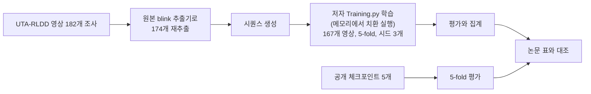

# 재현 결과와 검증

이 문서는 루트 [README.md](../README.md)의 4절(논문 재현과 검증)을 뒷받침하는 결과와 검증의 상세 표를 옮겨, 값과 상태가 무슨 뜻인지 함께 읽을 수 있게 정리한 것입니다. **새로 계산하거나 다시 실행한 값은 없고**, 아래 문서에 이미 적힌 값을 옮겼습니다. 숫자의 출처는 각 표 위나 아래에 적었습니다.

- README: 루트 [README.md](../README.md)
- 재현 보고서: [REPRODUCTION_REPORT.md](REPRODUCTION_REPORT.md) (보고서)
- 3시드 집계: [aggregate_seeds123.md](../experiments/02_fold_seeds/aggregate_seeds123.md) (집계 파일)
- 활용 트랙(코드 폴더 improve) 기록: [IMPROVEMENT_LOG.md](improvement/IMPROVEMENT_LOG.md) (로그, 항목 제목과 날짜로 가리킴)

## 1. 한 줄 요약

논문의 눈 깜빡임 기반 baseline(HM-LSTM 시간 모델)을 저자 공개 코드로 UTA-RLDD에서 다시 돌린 **재현**이며, 공개 체크포인트 평가는 논문 표와 비교 가능한 14칸 중 11칸이 일치하고 3칸이 일치하지 않았습니다. 영상에서 blink 특징을 다시 뽑아 학습한 B1은 영상 집합이 논문과 달라 같은 비교가 아니라서 재현 여부를 판정하지 않았고(미확정), 졸음 검출 주장, B1 대비 개선 주장, 점수 기반 알람은 하지 않았습니다.

## 2. 용어 설명

정의는 저장소 문서에서 찾을 수 있는 것만 적었습니다. 문서에 정의 문장이 없는 용어는 "미확정"으로 표시하고, 문서에서 실제로 쓰인 방식만 덧붙였습니다. 이 문서에서 처음 나오는 용어는 아래 표에서 찾으세요.

| 용어 | 정의 (출처) | 쉬운 말로 |
|---|---|---|
| baseline | 논문이 제안한 HM-LSTM 기반 시간 모델(보고서 1절). 이 저장소가 개선 실험에서 기준으로 삼는 결과는 "기준선"이라 부르며 B1입니다(EVALUATION_PROTOCOL.md 1절과 7절) | 논문의 모델이라는 뜻과, 이 저장소에서 다른 방법과 비교할 때 기준이 되는 결과라는 뜻으로 쓰입니다 |
| B0 | 저자가 제공한 npy와 공개 체크포인트로 얻은 값, 그리고 저자 npy로 우리가 재학습한 값(시드 1에서 3). 논문 수치와 함께 참고치(보고서 2절) | 저자가 준 데이터로 얻은 결과 묶음 |
| B1 | 우리가 재추출한 blink txt에서 만든 시퀀스(영상 167개)로 저자 `Training.py`를 메모리 치환해 시드 1, 2, 3으로 5-fold 학습한 결과(보고서 2절) | 영상에서 우리가 직접 특징을 다시 뽑아 학습한 결과 |
| 참고치 | B0와 논문 수치는 개선 판정의 기준이 아닌 별도 열의 비교용 값(EVALUATION_PROTOCOL.md 서두) | 옆에 놓고 보기만 하는 값 |
| fold | 공식 5 fold, 피험자 단위로 분리(보고서 부록 A) | 데이터를 5조각으로 나눠 돌아가며 시험하는 한 조각 |
| seed(시드) | 학습의 난수 시드. 원본에는 시드가 없어 재현용으로 고정(`reproduction_train_baseline.py --seed` 도움말, 보고서 4절 S1). B1은 시드 1, 2, 3으로 학습 | 같은 설정으로 학습을 몇 번 반복했는지 구분하는 번호 |
| blink 행 | blink 하나당 txt 한 줄(누적 blink 수, 100 곱한 빈도, 진폭, 지속 시간, 속도, 보고서 부록 A) | 깜빡임 하나를 숫자 다섯 개로 적은 줄. 다만 실제 눈 깜빡임 횟수와 정확히 같다고는 확인하지 못했습니다(한 번의 확정에서 여러 줄이 기록되기도 하고 일부는 기록되지 않습니다). |
| 시퀀스 | blink 30개 윈도우(폭 2로 이동). 30개 미만이면 앞쪽 0 패딩 한 개(보고서 부록 A) | 모델에 한 번에 넣는 깜빡임 30개 묶음 |
| 클래스 0, 5, 10 | 영상 라벨 0, 5, 10. UTA-RLDD의 alert, semisleepy, sleepy(보고서 부록 A) | 깨어 있음, 약간 졸림, 졸림 |
| BSA, BSRE | blink 시퀀스 단위 정답률과 회귀 오차(보고서 부록 A). BSA acc는 정답률 값 | 시퀀스 하나하나를 맞힌 비율과 오차 |
| VA | 영상 안 시퀀스 라벨의 다수결로 영상 라벨을 정하고 동률이면 영상 평균 예측으로 정함. 맞은 영상 수를 영상 수로 나눔(IMPLEMENTATION_DIFF.md 3.3절) | 영상 한 편마다 답을 하나 내고 그 답이 맞은 영상의 비율 |
| VRE | 영상의 시퀀스 예측을 평균해 영상을 판정하고, 틀린 영상에 대해 평균 예측과 가까운 경계값 사이의 제곱 오차를 더해 영상 수로 나눔. 정답 영상은 0(IMPLEMENTATION_DIFF.md 3.3절의 VRE 행) | 영상 단위 오차. 틀린 영상의 평균 예측이 정답 경계에서 얼마나 먼지를 모은 값 |
| 5-fold 평균 | 5개 fold의 값을 평균한 것. README는 단일 fold가 아니라 5-fold 평균을 보고하라고 안내(README 11절) | 한 조각이 아니라 다섯 조각 결과의 평균 |
| 낙관적 참고치 | 테스트 세트로 epoch를 고른 값. 주 결과가 아님(보고서 부록 A) | 시험 문제를 보고 고른 값이라 좋게 나오기 쉬운 참고용 숫자 |
| AUC | 양성 값이 음성 값보다 클 확률(동점 0.5). 이 저장소에서는 영상의 점수 최댓값 등으로 두 라벨 집단을 구분하는 지표(로그 "오프라인 점수 분석 결과 (2026-10-10)"의 표 3). 같은 항목에서 0.5 근처를 우연 수준으로 읽음 | 두 집단을 점수로 얼마나 가를 수 있는지의 수. 0.5면 가를 수 없는 정도 |
| 군집 부트스트랩 | 피험자를 단위로 재표집해 구간을 구하는 방법(보고서 부록 A) | 사람 단위로 표본을 다시 뽑아 값이 얼마나 흔들리는지 재는 방법 |
| 훅(후킹) | 저자 원본 `blink_video.py`를 메모리에서 치환 실행하고, 원본이 파일에 쓰는 깜빡임 행을 메모리로 받아 오는 방식(로그 "I-28 1단계: 메모리 치환 실행기와 B1 행 대조 결과 (2026-10-09)") | 원본 코드를 고치지 않고 실행 중에 값을 받아 보는 방법 |
| number_of_frames | 원본이 얼굴이 검출된 프레임만 세는 변수. 빈도의 분모가 된다(보고서 문제점 P-08) | 얼굴이 보인 프레임 수 |
| D4 | 활용 트랙의 점검 항목 이름. 종단 오라클(영상, 훅, 행, 창, 점수)을 32/0과 32/5로 한 번 실행하는 것(로그 "D4 종단 오라클 결과, 대본영상 대조, 그림 도구, 실측 시간 (2026-10-11)"의 D4 항목). 사전에 정한 기준(행 최대 차이 5e-5, 점수 차이 1e-5)과 비교 | 영상 한 편을 처음부터 점수까지 통째로 돌려 저장된 B1 값과 같은지 본 점검 |
| 오라클 | 이 단어 자체의 정의 문장은 찾지 못함(미확정). 검색한 곳: 보고서, IMPLEMENTATION_DIFF.md, 활용 트랙 DECISIONS.md, D1_REQUIREMENTS.md, 로그. 로그에서는 "사전 확정 기준(실행 전에 정함)"과 비교하는 점검에 쓰임 | 미확정 |
| 2a | 활용 트랙 결정 I-28의 2단계 2a. 행에서 창, 점수로 가는 모듈, 통계 설정 파일, 검증 도구, 폴드별 대조(로그 "I-28 2단계 2a 구현 결과와 보류 3항목 정리 (2026-10-10)") | 점수 계산 부분을 따로 만들어 폴드별로 맞춰 본 단계 |
| 32/0, 32/5, 32/10_1, 32/10_2 | 데이터셋의 피험자 32의 영상 파일 이름(로그의 표기를 그대로 씀). 파일 이름의 앞 숫자와 라벨의 관계를 설명한 문장은 찾지 못함(미확정) | 검증에 쓴 영상 이름 |

### 상태 단어

| 단어 | 정의 (출처) | 쉬운 말로 |
|---|---|---|
| 일치 | 비교한 두 값이 정한 기준에서 같음. 공개 체크포인트 14칸은 소수 둘째 자리 반올림 값이 논문과 같을 때(집계 파일 3절). 검증은 로그에 적힌 사전 기준 이내일 때 | 같다고 봐도 되는 정도로 맞음 |
| 불일치 | 같은 기준에서 값이 다름(집계 파일 3절의 판정 열) | 값이 다름 |
| 미확정 | 정의 문장은 찾지 못함. 사용 예: 영상 집합이 달라 같은 비교가 아니어서 재현 여부를 판정하지 않음(보고서 6절) | 아직 결론을 낼 수 없음 |
| 미검증 | 정의 문장은 찾지 못함. 사용 예: 격차의 원인을 확인하지 않음(보고서 6절). 문서에 따라 "미확인"과 같은 뜻으로 쓰인 곳이 있다 | 확인해 보지 않음 |
| 미확인 | 출처를 못 찾은 값(보고서 서두). README와 RUN_GUIDE에서는 직접 시험하지 않은 것도 "미확인"으로 적는다 | 근거를 찾지 못함 |
| 해당 없음 | 정의만 있어 판정할 대상이 아닌 항목(보고서 서두) | 판정 대상이 아님 |
| 결정 | 활용 트랙 DECISIONS.md는 로그에 있는 결정만 옮긴다(서두). 사용자 확정이 있는 결정이 많음 | 사용자가 정한 사항 |
| 해결됨, 미결 | 두 단어의 정의 문장은 찾지 못함(미확정). 사용 예: "해결됨(...)"은 다른 결정으로 처리된 항목, "미결"은 결정 대기 항목(DECISIONS.md의 I-W 표) | 끝난 항목, 아직 정하지 않은 항목 |
| [확실], [가능성 높음], [추측] | 확실도 표기. 보고서 서두에 이름만 있고 기준 문장은 찾지 못함(미확정) | 근거의 강도 표시 |

결정 번호는 접두사로 구분합니다. 예: 활용 트랙 결정 I-33과 I-W 계열의 I-W-33은 서로 다른 항목입니다.

## 3. 재현 흐름

- 위 그림의 숫자는 보고서 3절과 같습니다: 디스크의 영상 182개, 우리 추출 대상 174개(manual_flags 8개 제외), B1에 포함된 영상 167개(피험자 57명), 공개 체크포인트 `my_model1`에서 `my_model5`까지 5개.
- **174가 두 가지 뜻으로 쓰입니다.** 저자 코드의 테스트 영상 174개와 우리 추출 대상 174개는 개수가 같아도 같은 집합이라는 뜻이 아닙니다(보고서 3절, 문제점 P-23).
- 182개 중 15개는 B1에서 빠졌습니다(변형 파일 보류 4, 추출 보류 8, blink 파일 없음 1, 정상 구간 기준 없음 2). 저자가 제외한 영상은 확인하지 못했습니다(보고서 3절).

## 4. 결과

### 4.1 요약 (README 5절)

수치는 [aggregate_seeds123.md](../experiments/02_fold_seeds/aggregate_seeds123.md)와 [REPRODUCTION_REPORT.md](REPRODUCTION_REPORT.md)의 값 그대로입니다. 약어는 원본 `Training.py`가 출력하는 지표 이름이고 VA는 영상 단위 정답률입니다. SD는 표본 표준편차(n에서 1을 뺌)입니다.

| 항목 | 값 | 상태 | 쉬운 말로 |
|---|---|---|---|
| 공개 체크포인트 평가 vs 논문 Table 2와 3 | 비교 가능한 14칸 중 11칸 일치, 3칸 불일치(Fold3 VA 논문 0.700 대 0.69, Fold3 VRE 0.580 대 0.67, 평균 VRE 1.140 대 1.16). 원인 미확인 | 일치 11, 불일치 3 | 저자가 공개한 모델을 그대로 돌리면 논문 표의 대부분은 나오지만 세 칸은 다름 |
| B0: 저자 npy 재학습 5-fold 평균 VA | 0.556 ± 0.036(시드 3개, SD는 n에서 1을 뺌). 공개 체크포인트 0.649, 논문 0.652 | 불일치(원인 미검증) | 저자 데이터로 처음부터 다시 학습하면 공개 모델보다 낮게 나옴. 이유는 모름 |
| B1: 우리 재추출 데이터 5-fold 평균 VA | 0.586 ± 0.015(시드 3개, 마지막 epoch), VRE 1.498 ± 0.282 | 영상 집합이 달라 위 값과 같은 비교가 아님(미확정) | 우리가 뽑은 데이터로 학습한 결과. 영상이 달라 위 값들과 나란히 비교할 수 없음 |
| B1 클래스별 영상 정답률(시드 합산) | 클래스 0 0.731, 클래스 5 0.327, 클래스 10 0.698 | 클래스 5가 세 시드 모두 가장 낮음 | 깨어 있음과 졸림은 어느 정도 맞히지만 가운데(약간 졸림)는 잘 못 맞힘 |
| 영상 요약 특징만 쓴 진단 분류기(재현이 아닌 한계 분석) | 로지스틱 0.540, RF 0.559, 다수 클래스 0.341 | 참고 | 시간 구조 없이 영상 전체의 요약 숫자만 쓰는 단순한 방법도 이 정도 나옴. B1과 견주는 용도 |
| B1 VA의 95% 구간(피험자 군집 부트스트랩) | 0.5848 [0.5302, 0.6380] | - | 영상 167개로는 이 정도 범위에서 흔들릴 수 있음 |
| B1 − RF의 VA 차이 | +0.0279 [−0.0575, 0.1118] | 구간이 0을 포함해 구분할 수 없음(차이가 없다는 증거는 아님) | 두 방법 중 어느 쪽이 낫다고 말할 수 없음 |

- 보고값은 epoch 80의 단일값이며 사후 선택을 하지 않았습니다. 시드가 3개뿐이어서 SD는 참고 수준입니다.
- 재추출한 특징은 저자 npy와 영상 단위로 거의 일치하지 않습니다(값이 일치한 영상은 피험자 2명, 원인 미검증).
- B1 VA는 두 가지 방식으로 적혀 있습니다. 0.586은 fold 평균(시드 3개의 평균), 0.5848은 영상을 합산한 정답률의 점추정이라 정의가 다른 값입니다(IMPLEMENTATION_DIFF.md의 표기 정리 항목).
- 원본 대비 차이 목록: [IMPLEMENTATION_DIFF.md](IMPLEMENTATION_DIFF.md). 오류를 포함한 단계별 기록: [REPRODUCTION_LOG.md](REPRODUCTION_LOG.md).

### 4.2 공개 체크포인트 평가 14칸 (집계 파일 3절, 보고서 5.1)

소수 둘째 자리 반올림 값이 논문과 같으면 일치로 셉니다.

| 항목 | 논문 | 공개(원값) | 공개(소수 둘째 자리 반올림) | 판정 | 쉬운 말로 |
|---|---|---|---|---|---|
| Fold1 VA | 0.640 | 0.636 | 0.64 | 일치 | 같음 |
| Fold1 VRE | 2.420 | 2.420 | 2.42 | 일치 | 같음 |
| Fold2 VA | 0.610 | 0.611 | 0.61 | 일치 | 같음 |
| Fold2 VRE | 1.040 | 1.040 | 1.04 | 일치 | 같음 |
| Fold3 VA | 0.700 | 0.694 | 0.69 | 불일치 | 0.01 낮음 |
| Fold3 VRE | 0.580 | 0.667 | 0.67 | 불일치 | 오차가 더 큼 |
| Fold4 VA | 0.640 | 0.639 | 0.64 | 일치 | 같음 |
| Fold4 VRE | 0.850 | 0.850 | 0.85 | 일치 | 같음 |
| Fold5 VA | 0.670 | 0.667 | 0.67 | 일치 | 같음 |
| Fold5 VRE | 0.810 | 0.812 | 0.81 | 일치 | 같음 |
| 평균 BSRE | 1.900 | 1.901 | 1.90 | 일치 | 같음 |
| 평균 VRE | 1.140 | 1.158 | 1.16 | 불일치 | 오차가 더 큼 |
| 평균 BSA acc | 0.540 | 0.541 | 0.54 | 일치 | 같음 |
| 평균 VA | 0.652 | 0.649 | 0.65 | 일치 | 같음 |

- 비교 가능한 14칸 중 11칸 일치, 3칸 불일치입니다. 논문에 값이 없어 비교하지 못하는 칸이 있습니다(5개 fold의 BSA loss, BSA acc, BSRE 등, IMPLEMENTATION_DIFF.md).
- 평균 VA는 0.649, 0.6495 등 자릿수가 다르게 적힌 곳이 있습니다. 같은 값의 자릿수 차이입니다(IMPLEMENTATION_DIFF.md의 표기 정리 항목).
- 새 폴더 구조에서 다시 실행했을 때 이전 실행 결과와 25개 값이 같았습니다. 자체 일관성 확인이며 논문과의 비교가 아닙니다(로그 "정정 (2026-10-01)", 보고서 5.1).

### 4.3 B0 저자 npy 재학습, 시드별 5-fold 평균 (집계 파일 1절, 보고서 5.2)

| 지표 | 시드1 | 시드2 | 시드3 | 평균 ± SD(n-1, n=3) | 공개 체크포인트 | 논문(Table 2) |
|---|---|---|---|---|---|---|
| BSA loss | 13.957 | 14.101 | 13.736 | 13.931 ± 0.184 | 12.271 | 논문에 없음 |
| BSA acc | 0.517 | 0.512 | 0.489 | 0.506 ± 0.015 | 0.541 | 0.540 |
| VA | 0.535 | 0.597 | 0.534 | 0.556 ± 0.036 | 0.649 | 0.652 |
| BSRE | 3.157 | 2.748 | 2.718 | 2.874 ± 0.245 | 1.901 | 1.900 |
| VRE | 2.580 | 1.587 | 1.692 | 1.953 ± 0.546 | 1.158 | 1.140 |

쉬운 말로: 같은 입력과 하이퍼파라미터로 다시 학습한 세 번의 결과가 공개 체크포인트보다 모든 지표에서 나쁘게 나왔고(BSA loss는 값이 큼) 원인은 확인하지 못했습니다(보고서 5.2, 문제점 P-17).

### 4.4 B1 fold별 영상 단위 VA (보고서 5.3, 로그 "B1 기준선 학습 결과 집계 (2026-10-04)")

| 영상 단위 VA | Fold1 | Fold2 | Fold3 | Fold4 | Fold5 | 5-fold 평균 |
|---|---|---|---|---|---|---|
| 시드1 | 0.485 | 0.818 | 0.486 | 0.562 | 0.647 | 0.600 |
| 시드2 | 0.515 | 0.727 | 0.514 | 0.562 | 0.618 | 0.587 |
| 시드3 | 0.576 | 0.576 | 0.486 | 0.625 | 0.588 | 0.570 |
| 시드 평균 | 0.525 | 0.707 | 0.495 | 0.583 | 0.618 | 0.586 |
| 시드 SD(n-1) | 0.046 | 0.122 | 0.016 | 0.036 | 0.029 | 0.015 |

쉬운 말로: fold에 따라 0.495에서 0.707까지 크게 달라서 한 fold만 보면 판단이 흔들립니다. 정상성 점검 5개는 모두 통과했고 재평가한 VA는 마지막 epoch 지표와 15개 fold 모두 일치했습니다(보고서 5.3, 5.4). 낙관적 참고치(테스트 세트로 epoch를 고른 값)는 5-fold 평균 VA가 시드1 0.648, 시드2 0.648, 시드3 0.623이며 주 결과가 아닙니다.

## 5. 검증

### 5.1 요약 (README 8절과 활용 트랙 로그)

| 검증 | 결과 | 상태 | 쉬운 말로 |
|---|---|---|---|
| 종단 대조 D4(영상, 훅, 행, 창, 점수), 32/0 | 행 58개가 B1과 같고 열별 최대 차이 0, 폴드 3 영상 평균 4.621983(B1 4.621983, 차이 4.732e-07, 허용 1e-5) | 일치 | 영상에서 점수까지 통째로 돌린 결과가 저장된 B1 값과 같음 |
| 종단 대조 D4, 32/5 | 행 140개가 B1과 같고 열별 최대 차이 0, 폴드 3 영상 평균 7.463169(B1 7.463170, 차이 6.041e-07) | 일치 | 위와 같음 |
| 프레임 번호 대조, 32/10_2 | 행 9개, 프레임 3789, 첫 행 945, 마지막 행 3547, B1 행과 최대 차이 0 | 일치 | 행마다 몇 번째 프레임에서 확정됐는지 기록해도 값이 바뀌지 않음 |
| 폴드 1에서 5 점수 대조(2a) | 창 값 차이 0, 점수 영상 평균 차이 2.4e-07에서 8.7e-07(허용 1e-5) | 일치 | 5개 fold 모델 모두에서 점수 계산 모듈이 기존 값과 같음 |
| B1 행 동등성(훅 대 B1 blinks 파일), 32/10_2와 32/10_1 | 행 수 9 대 9와 36 대 36, 다섯 열의 열별 최대 차이 0.000000, 4자리 반올림이 다른 행 0 | 일치 | 원본 코드를 메모리에서 실행해 얻은 깜빡임 행이 B1이 쓴 행과 같음 |
| EAR, 얼굴 유무, number_of_frames, 행 일치(훅 대 replay_precompute, 32/10_2) | 프레임 수 3789 일치, 얼굴 유무 일치, 검출 프레임의 EAR 차이 최댓값 0, number_of_frames와 얼굴 있음 누적 개수가 모든 프레임에서 일치(최종 3789), 알람 0 대 0, 콜백 예외 0. 깜빡임 행은 비교하지 않음 | 일치 | 훅으로 받은 눈 감김 수치가 따로 만든 계산과 같음 |
| 같은 검증, 32/0 | 프레임 수 10788 일치, 얼굴 있음 프레임 10787, 추적 프레임 1, 얼굴 유무 일치, EAR 차이 최댓값 0, number_of_frames 최종 10787로 모든 프레임에서 일치, 알람 0 대 0, 콜백 예외 0. 훅이 만든 깜빡임 행 58개가 행 파일 58개와 4자리까지 일치(다섯 열 최대 차이 0) | 일치 | 위와 같고 깜빡임 행까지 같음 |
| 라이브 재채점 비교(`live_score_recheck`, 웹캠 실행 4의 숫자 JSON) | 기준 행 195와 기준 통계 일치, 창 100개 프레임 번호 불일치 0, 점수 차이 0(허용 1e-4), 마지막 창 3.2689 [2.4551-4.0897] 동일 | 일치(같은 LiveSession 코드로 같은 행을 다시 채점한 비교, B1 오프라인 경로와의 비교가 아님, 1회) | 웹캠 실행 중 만든 점수가 저장된 행을 다시 채점한 값과 같음. 자식 프로세스와 스레드 경로가 값을 바꾸지 않았다는 확인 |

### 5.2 검증의 범위와 한계

- D4와 프레임 번호 대조, EAR 일치 검증은 회전이 없는 데이터셋 영상(피험자 32의 영상 몇 개)에서만 했습니다. 회전 메타데이터가 있는 영상의 `--rotate auto` 경로, 다른 해상도와 fps 영상은 확인하지 않았습니다(미검증, 로그의 D4 항목과 "라이브 세션 1단계와 EAR 일치 검증 결과, I-W-32 정정 (2026-10-12)").
- D4의 이전 측정(영상 평균 비교)은 차이가 4.26e-07과 4.25e-07이었고 이번 차이는 4.73e-07과 6.04e-07입니다. 작은 차이가 있으며 원인은 미확정입니다. 모두 허용 오차 이내입니다(로그의 D4 항목).
- EAR 일치 검증에서 추적 분기는 한 프레임만 실행되어 그 프레임의 EAR는 비교되지 않았고, 알람이 두 영상 모두 0 대 0이라 알람 시각 비교는 이루어지지 않았습니다. 이 검증은 규칙 알람의 검증을 대체하지 않습니다(같은 로그 항목).
- 재채점 비교는 같은 코드로 같은 행을 다시 채점한 것이므로 LiveSession의 논리 자체나 B1 오프라인 경로와의 비교가 아닙니다. 웹캠 실행은 한 사람, 한 대의 카메라 관찰입니다. 남은 미검증 목록은 로그 "live_combined 두 번째 전체 실행과 재채점 비교 (2026-10-13)"의 I에 있습니다.
- 평가 규칙과 사전 등록 문서는 결과를 본 뒤 바꾸지 않고 변경 이력이나 일탈 표에 추가합니다([EVALUATION_PROTOCOL.md](EVALUATION_PROTOCOL.md)).

## 6. 하지 않은 것과 한계

자세한 내용은 README의 2절과 9절, 보고서 6절과 8절에 있습니다. 요약만 적습니다.

**하지 않은 것**(README 2절)

- 영상 수 174/180의 확정(저자가 어떤 영상을 제외했는지는 미확인)
- 저자 npy와 우리 재추출 특징의 영상 단위 일치(일치한 영상은 피험자 2명, 원인 미검증)
- B1 대비 개선 실험과 개선 주장
- 3.0초 경계의 실제 영상 시험(합성 시험 12개로만 고정)
- 점수 기반 알람, 졸음 검출 주장, 점수의 타당성 검증
- 웹캠 라이브 점수와 B1 오프라인 경로의 세션 전체 비교(영상을 저장하지 않아 불가)
- 논문의 비교 실험(HM-LSTM, 일반 LSTM, 완전연결 층만 쓴 변형 모델, 논문 5.3절 표 2), 사람 판단 실험(논문 3.4절), 입력 길이 T와 Δ의 민감도 실험(논문 그림 4)은 다시 하지 않았습니다. 논문 PDF는 저장소에 없어 arXiv 1904.07312로 가리킵니다.
- 시퀀스 생성은 저자 전처리와 같은 계산을 직접 구현했고, 모델 학습과 깜빡임 추출은 저자 코드를 고치지 않고 실행했습니다
- 하품과 고개 떨굼 검출

**한계**(README 9절, 보고서 8절)

- 사건과 점수의 대조는 대본영상 한 건(한 사람의 한 번 촬영)이라 점수가 졸음을 반영하는지 말할 수 없습니다.
- 졸음 검출을 주장하지 않습니다. 규칙 알람은 눈 감김 규칙 하나뿐이고 점수는 참고용입니다. 의료 기기도, 안전 장치도 아닙니다.
- B1 대비 개선을 주장하지 않습니다. B1과 논문의 수치는 영상 집합이 달라 같은 비교가 아닙니다.
- 재현 결과는 논문 표와 일부 칸이 일치하지 않습니다(14칸 중 3칸). 공개 체크포인트와의 차이의 원인은 확인하지 못했습니다.
- 표본이 작습니다(영상 167개, 피험자 57명, 시드 3개). 영상 하나가 fold VA를 약 0.03 움직이고 SD는 참고 수준입니다.
- 논문도 자신의 결과가 운전 환경을 대표한다고 주장하지 않습니다(논문 서론, 2쪽).
- 환경이 오래되었고(Python 3.6, TensorFlow 1.8) Windows에서만 실행해 봤습니다.
- 라이브 점수의 기준 구간(처음 300초)이 졸음 없는 상태라는 보장이 없습니다(활용 트랙 결정 I-W-29).

문서 안내: [README.md](../README.md), [REPRODUCTION_REPORT.md](REPRODUCTION_REPORT.md), [IMPLEMENTATION_DIFF.md](IMPLEMENTATION_DIFF.md), [CLAIMS_LEDGER.md](CLAIMS_LEDGER.md)(말해도 되는 주장과 금지 표현), [improvement/DECISIONS.md](improvement/DECISIONS.md)(활용 트랙의 결정), [RUN_GUIDE.md](RUN_GUIDE.md)(실행 방법).
